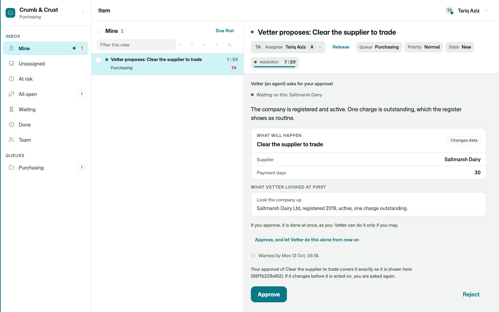
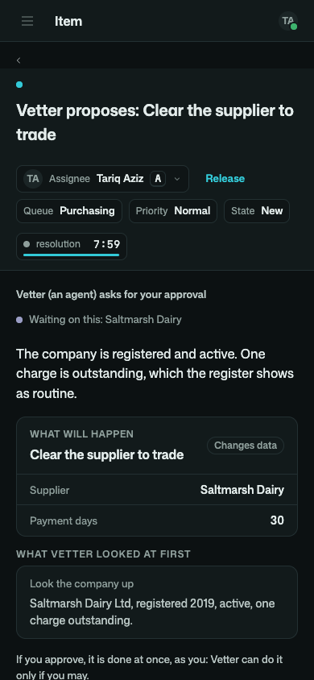
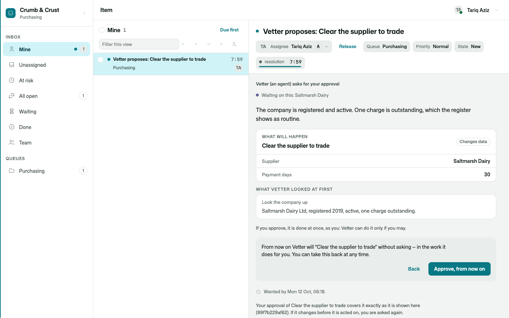
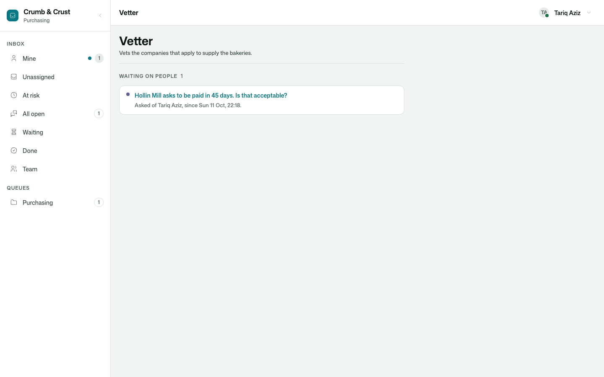
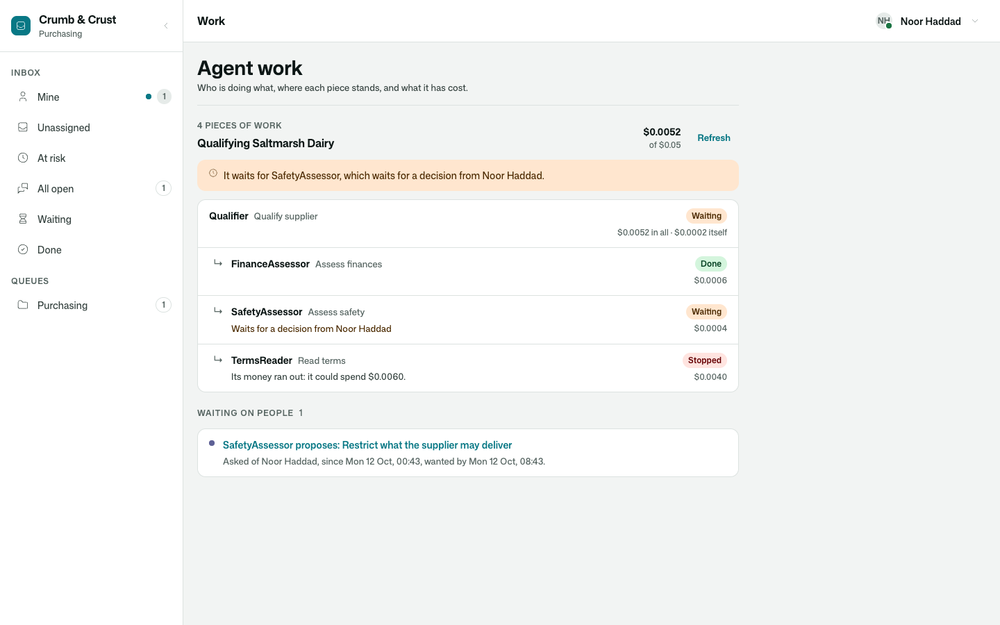
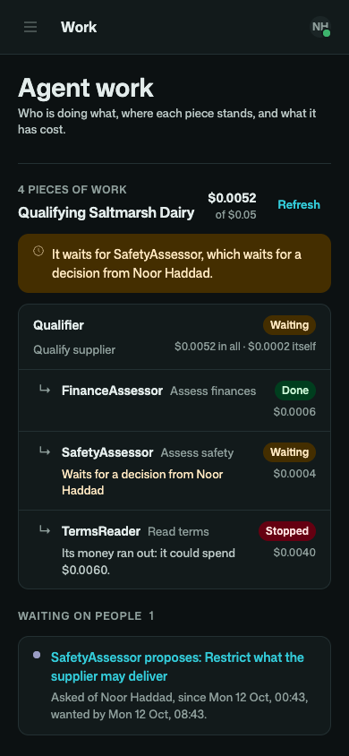

# Osysharp.Agents.HumanRequests

An agent's proposals and questions, in the inbox of the person they are for — and their answer carried back to the
work that waits for it.

An agent that may not do something alone proposes it. An agent that needs a person asks one. With
[`Osysharp.Agents`](../agents) and [`Osysharp.HumanRequests`](../human-requests) both in an app, this package is the
bridge between them: nothing to wire.

```osy
use Osysharp.Agents@1;
use Osysharp.HumanRequests@1;
use Osysharp.Agents.HumanRequests@1;

[Actor(Roles = [OfficeRole.Vetting])]
public class Vetter : Agent {
  public override List<SkillBase> Skills => [new VetSupplier()];
  public override Permits May => new Permits { Alone = [Actions.Of(NoteRisk)] };      // the rest is proposed
  public override AsksPeople People => new AsksPeople { MayChoose = true };           // and it may ask a person
}

var outcome = await Agents.Of<Vetter>().Do(new VetSupplier(), supplier);
// outcome.Waiting — its proposal is an approval in the lead's inbox. Her yes clears the supplier, as her.
```



## Use case

An agent that can change things is only useful if somebody can say yes to the changes that matter — and "the agent
wants to do something, click OK" is not a yes to anything. The person deciding needs to see the exact call, on the
record it will touch, with the agent's reason and what it had looked at; and the yes has to mean what it says.

- **The proposal is the exact call.** The action by its label, each argument by name — a supplier by its name, not
  its id — whether it changes data, sends or spends, why the agent wants to, and what it read first.
- **A yes runs it as whoever said yes.** The tool does only what both the agent and that person may. A buyer who
  approves what only the lead may do has not done it, and the sheet says so.
- **A yes is to what was shown.** If the thing changed since it was proposed, nothing runs and the agent looks again.
- **A no carries its reason to the agent**, which goes on from it.
- **"From now on, alone."** Somebody the app trusts with that can approve this one and let the agent do the same
  without asking, in the work it does for them — told what that means before it is said, and free to take it back.
- **A question is a question.** With the agent's options as buttons, or a box to write in.
- **The work waits, and costs nothing while it does.** A minute or a month; a process that gave the work waits with it.
- **An inbox item can be handed to an agent, and taken back.** The agent's account holds it while it works; it comes
  back by itself with what the agent found.
- **Work an agent gave up on does not vanish.** It is put to its sponsor.



## What it does

| | |
|---|---|
| **Proposals** | Each `AgentProposal` becomes an approval request to the person it is put to: title "*Agent* proposes: *action*", the agent's reason as its context, the piece of work as what waits on it. The sheet draws the call (`ProposalCardOf`). Approve / Reject are the request's own; a no asks why. |
| **Questions** | Each question an agent puts to a person becomes a question request, with its options. The answer — the option chosen and what was written beside it — is what the agent's `ask_person` answered. |
| **The answer goes back** | `HumanRequestAnswered` → `ApproveAgentProposal`'s own checks, as whoever answered. A request called off or out of time is a no with that as its reason; a proposal decided elsewhere calls its request off. |
| **From now on, alone** | `ApproveAndAllowAlone(proposal, request)` — the button on the sheet, for whoever `WidensAgentAutonomy` admits. |
| **Handing over** | `AgentDesk.Hand(item, agent, skill, input)` · `AgentDesk.TakeBack(item, why)` · `AgentDesk.Of(item)` · `AgentDesk.TrailOf(item)` — `AgentHandover` rows; events `WorkHandedToAgent`, `WorkBackFromAgent`. |
| **Given up** | `AgentWorkGaveUp` → a question to the agent's sponsor (`TellSponsorOfFailures`). |
| **Who is waited on** | `AgentWaitingOnPeople(agent)` · `WorkWaitingOnPeople(task)`. |
| **The tree of a piece of work** | `AgentWorkTree(task, open:)` — on the work's own page: what it is about, how many pieces, what the whole has cost of what it may, what it waits for, and each piece under the one that handed it on with where it stands and what it cost. `WorkWaitingOnPeople(task)` lists the requests behind the piece and behind everything it handed on. A request from handed-on work says through whom it comes: "Checker, working for Coordinator". |
| **Setting** | `app.AgentRequests = new AgentRequestsSetup { Queue, DecideWithin, AnswerWithin, GiveUpAfter, Hours, TellSponsorOfFailures }`. |



## What the app says

Nothing new. The agents kit's policies decide who gives agents work, who supervises them and who may widen what one
does (`WidensAgentAutonomy`); the requests kit's and the inbox's decide who works which queue. The agent's own
account needs to be able to hold an item (`WorksInbox`, and a place in the queue) only if items are handed to it.



`AgentWorkTree(task)` is a piece of work's own page: one agent in charge, the pieces it handed on, where each
stands, what it waits for and what it cost.





## Tests

`tests/` is the purchasing office of a bakery group taking on a supplier — walked end to end in one test: the
company, which has no account, is sent a link and fills in its details; the vetter looks it up, asks the purchasing
lead about the payment term and waits a week for her; proposes to clear the supplier; she approves in her inbox and
it is cleared as her; the process that started it all goes on. A second walk qualifies a supplier with one agent
in charge and three assessors at work at once: one finishes, one proposes a restriction that waits three days in the
buyer's inbox — saying through whom it comes — and one runs out of its allowance; she approves, every piece goes on,
and one typed qualification comes back. 22 tests in all — the two walks, who a yes runs as, a no with its reason, a
request decided elsewhere or called off, "from now on, alone", handing an item to the agent and taking it back, work
it gave up on, the tree of a piece of work — and the screens driven as a person (`osy test --pixels` photographs
them wide and on a phone, light and dark). No model is called: its one model is scripted.

## Source and package

- Source: [`kits/agents-human-requests`](.) — Osy#, readable and forkable.
- Package: `Osysharp.Agents.HumanRequests` · completes `Osysharp.Agents` and `Osysharp.HumanRequests`.
- Reference: `osy docs agent-requests` · `osy docs agent-autonomy` · `osy docs agent-people`.
