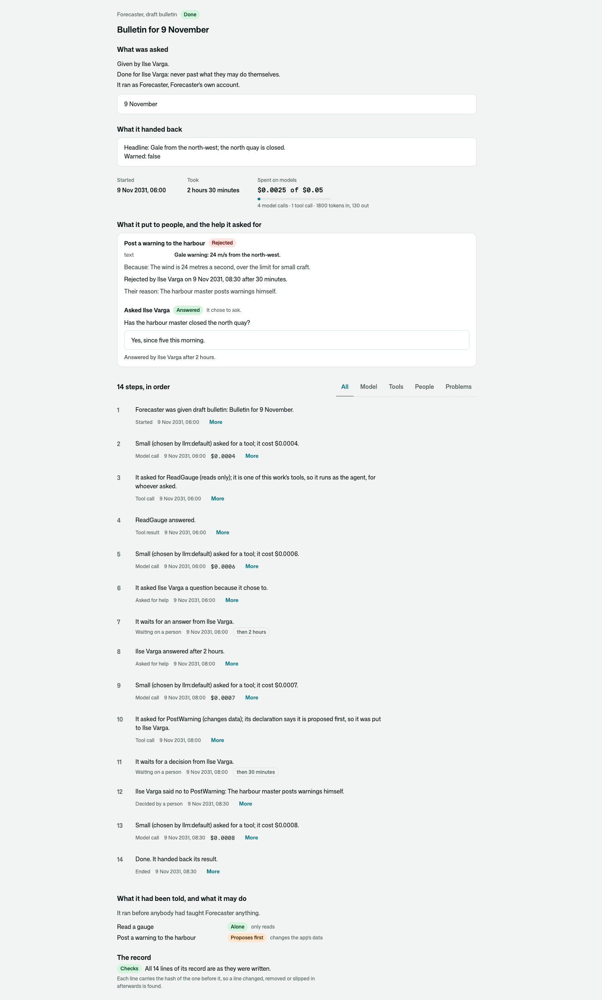
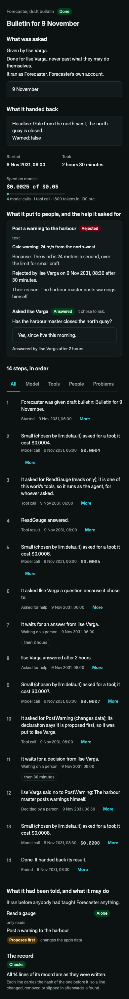

# Osysharp.Agents.Inspector

One piece of an AI agent's work, on one page, readable by a person who was not there.

```osy
use Osysharp.Agents@1;
use Osysharp.Agents.Inspector@2;

app.AgentInspector = new AgentInspectorSetup { WorkPage = "/work/{task}/{step}" };

[Route("/work/{task}/{step}")] [Authorize(UsesAgents)]
component WorkPage(Guid task, int step) { render { WorkInspector(task, step: step); } }
```



## Use case

Somebody asks, a week later, *why did the agent approve that?* The person answering was not there. Everything they
need was recorded — the receipt, the record of every step, the proposal, the question, the instructions in force —
and none of it reads as an answer until it is laid out in the order a person asks:

- **What it was, and how it ended** — the agent, the skill, what the work was about, done or failed and why, or
  what it is waiting on and for how long.
- **What was asked** — who gave the work, who it was for, and as which account it ran; what it was given, as the
  model was shown it; the process it was a step of.
- **What it handed back.**
- **In figures** — when, how long, what it spent against what it may, and what else it was charged to.
- **What it put to people, and the help it asked for** — each proposal as the exact call, why, who it was put to,
  who decided, after how long, and their reason; each question, its answer and how long the answer took.
- **The work it is part of** — when it handed work on, the tree, with what each piece cost.
- **Every step, in order** — each model call with the model, the rule that chose it and what it cost; each tool
  with its arguments as a person reads them and what it answered; each wait with how long it lasted. Narrowed to the
  model's steps, the tools', the people's, or only what went wrong. Each step's number is its link.
- **What it had been told, and what it may do** — the instruction set it ran with, what has been made active since
  that it had not been sent, and each tool with whether the agent runs it alone, proposes it, or never does.
- **The record** — whether its chain still checks: no line changed, removed or slipped in.
- **What was erased, shown as erased** — never as if it had not been there.

It changes nothing and widens nothing. Every line is read as whoever is looking, under the rules
[`Osysharp.Agents`](../agents) declares: whoever the work was for and whoever gave it read it with what it said;
whoever supervises reads that each step happened, and not what it said; whoever audits reads all of it. A piece of
work that is not the reader's says so.



## What it draws

| | |
|---|---|
| `WorkInspector(task, step:, embedded:)` | The whole page. `step` marks the step a link named; `embedded` leaves out the headline, for the work shown inside another page. |
| `InspectedStepLine(step)` · `InspectedProposalCard(p)` · `InspectedHelpCard(h)` | The pieces, for a page of your own. |
| `InspectAgentWork(task)` → `WorkInspection?` | Everything the page shows, as values — null when the work is not the reader's. |
| `WorkPageOf(task, step)` | The address of a piece of work, and of one step, on the app's own page. |
| `AgentWorkPanel(task)` | A slot under the record. "Correct this" from [`Osysharp.Agents.Teaching`](../agents-teaching) goes there in three lines: `[Contribution("Teaching")] component TeachHere(Guid task) : AgentWorkPanel { render { WorkTeaching(task, beside: true); } }` |
| `AgentWorkOrigin(task)` | A slot beside who asked. [`Osysharp.Agents.Processes`](../agents-processes) fills it with the process run the work is a step of. |


## Its tests

`kits/agents-inspector/tests` is a small weather station whose daily bulletin is drafted by an agent: it reads the
wind, asks the duty meteorologist whether the north quay is closed — she answers two hours later —, proposes a gale
warning, which she turns down with a reason, and hands the bulletin back. No model is ever called.

| | |
|---|---|
| Work done for a person is told with its question, its proposal and every step | `work_done_for_a_person_is_told_with_its_question_its_proposal_and_every_step` |
| Work that waits says on whom and since when | `work_that_waits_says_on_whom_and_since_when` |
| Each reader is shown what the agents kit lets them read, and no more | `each_reader_is_shown_what_the_agents_kit_lets_them_read_and_no_more` |
| Something the agent was only asked is inspected like any work | `something_the_agent_was_only_asked_is_inspected_like_any_work` |
| On screen, wide and on a phone, light and dark | `a_meteorologist_reads_the_bulletins_work_on_its_page`, `somebody_elses_work_says_that_it_is_not_yours` |

A whole process read through it — a step that failed twice, a three-day wait on an approval, erased content, a
reader who supervises without auditing — is in [`kits/agents-processes/tests`](../agents-processes/tests).

```
osy test kits/agents-inspector/tests            # 6 tests
osy test kits/agents-inspector/tests --pixels   # the same in a real browser, photographed
```

## Source and package

- Package: `Osysharp.Agents.Inspector` — `use Osysharp.Agents.Inspector@2;`
- Source: [`kits/agents-inspector`](.) — `model/Inspect.osy` (what the page reads), `model/ui/Work.osy` (the page)
- Uses [`Osysharp.Agents`](../agents) (receipts, records, proposals, help, instructions), [`Osysharp.Llm`](../llm)
  and `Osysharp.Ui`.

## Changes

- 2.0.0: `Fact` is internal to the kit. It was never meant as part of its surface, and its name is the same as the
  `Osysharp.Ui` control `Fact`, which an app reaches for instead. Pin `@2`.
