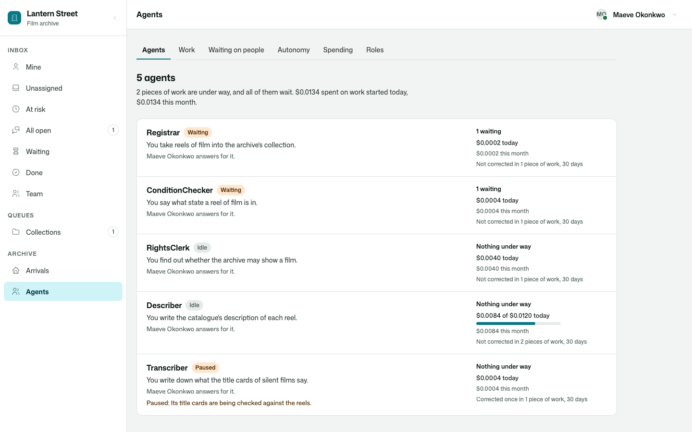
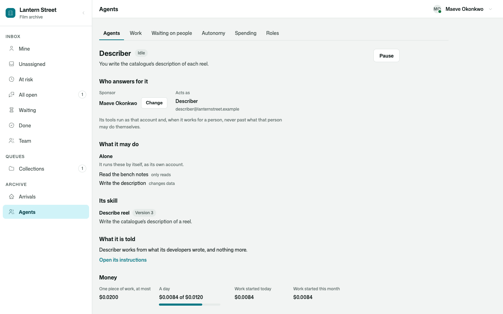
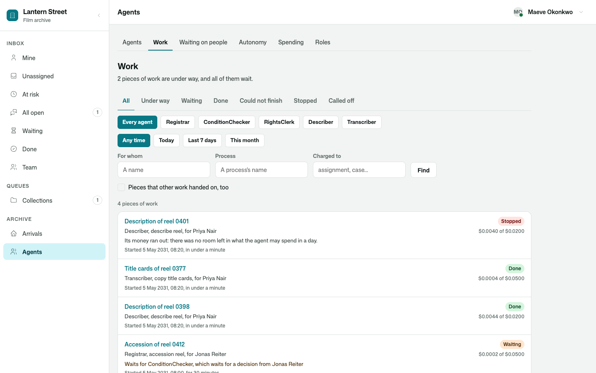
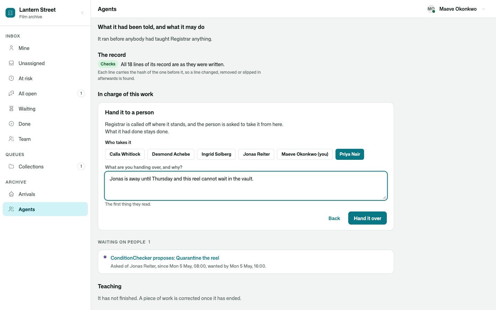
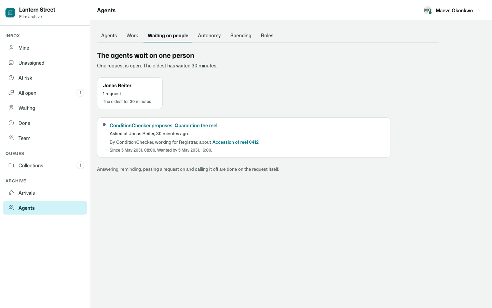
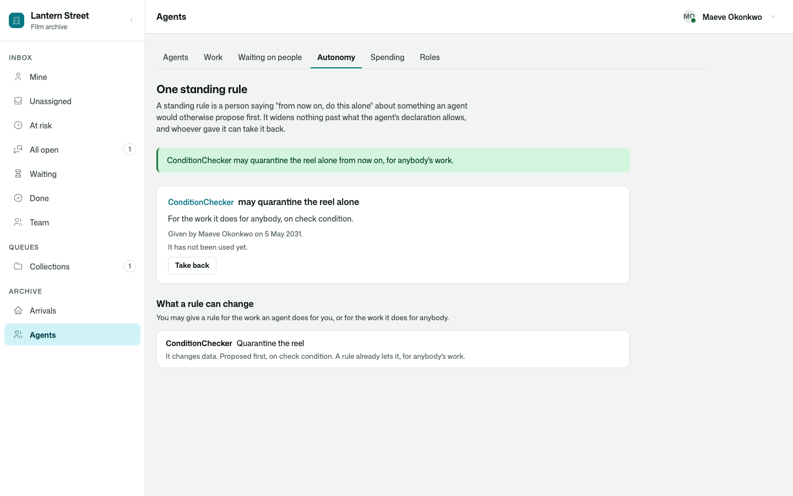
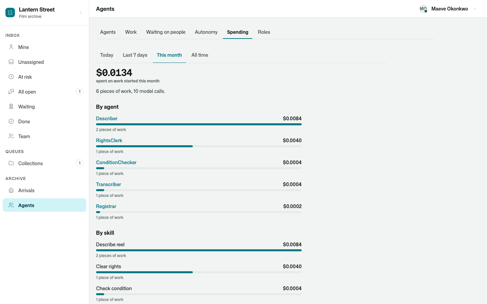
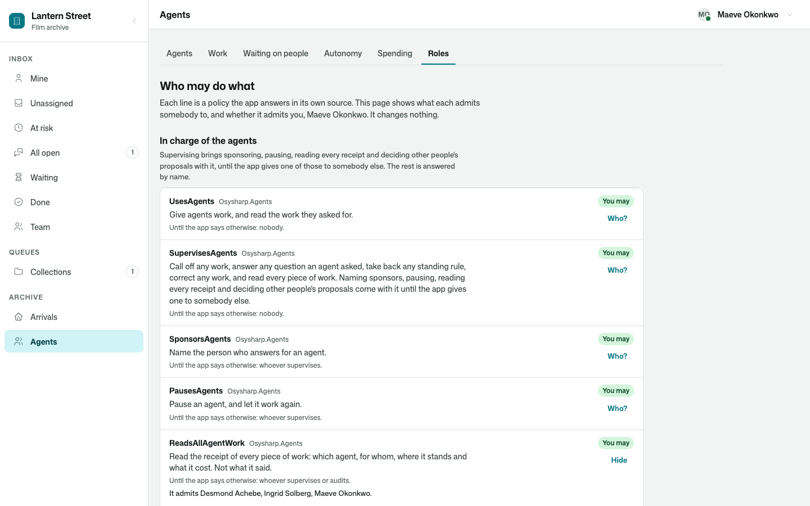
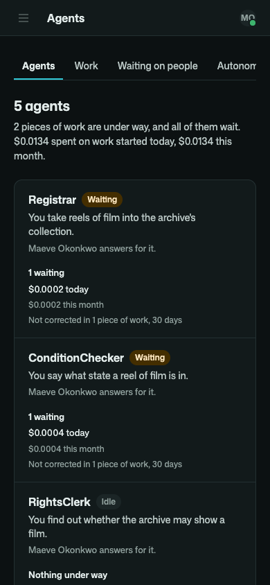

# Osysharp.Agents.Management

The place a person runs an app's AI agents from: every agent, all their work, everybody they are waiting on, the
standing rules that let them do more alone, what they cost, and who may do what.

```osy
use Osysharp.Agents@1;
use Osysharp.Agents.Management@1;

// Three routes, and all of it is there. A request opens in the inbox.
[Route("/agents")]                [Authorize(UsesAgents)] component Agents()                              { render { AgentsManagement(request: r => "/inbox/open/i/" + r); } }
[Route("/agents/{section}")]      [Authorize(UsesAgents)] component AgentsSection(string section)         { render { AgentsManagement(section, request: r => "/inbox/open/i/" + r); } }
[Route("/agents/{section}/{id}")] [Authorize(UsesAgents)] component AgentsItem(string section, string id) { render { AgentsManagement(section, id, request: r => "/inbox/open/i/" + r); } }
```



## Use case

Giving an agent a job is the easy half. The other half is the morning after: which agents are working and which are
stuck, who they are waiting on and for how long, what yesterday cost, why one of them stopped, and who is allowed to
do something about it. That is a supervisor's work, and it needs a place.

- **Every agent on one page.** Who answers for it, whether it is working, waiting, idle or paused, what it has under
  way, what it has spent today against what it may, and how often people corrected its work.
- **One agent, in full.** The account it acts as; what it does alone, what it proposes to a person first and what it
  never does, tool by tool; its skills and their versions; the agents it hands work to; what it is told; its limits.
  **Pause** it with the reason, let it work again, name who answers for it, call off what it has under way. Every
  one of those is written down with who did it.
- **All the work, findable.** Narrow it by where it stands, by agent, by when it started, by who it is for and by
  what it was charged to. Each piece opens as the whole of it: what was asked, each step, the work it handed on,
  what it cost.
- **Three things to do to a piece of work.** Call it off. Try it again from the beginning. Hand it to a person, who
  is asked to take it from here in their inbox.
- **Everybody the agents wait on.** Each person, how many requests they hold, how long the oldest has waited, and
  which are late.
- **What agents do alone because somebody said so.** Every standing rule, who gave it, how often it has been used,
  and Take back.
- **What it cost.** By agent, by skill, by who it was for and by what it was charged to; every limit with what has
  been counted against it; and the work a limit stopped. Read from the records: no model is asked anything.
- **Who may do what.** Every policy about the agents in one table, and whether it admits you.



## What it draws

| | |
|---|---|
| `AgentsManagement(section, id, at:, request:)` | All of it under one path: a strip of six links and the screen the path names. |
| `AgentRoster(at)` | Every agent of the app. |
| `AgentProfilePage(agent, at, request)` | One agent, with Pause, Resume, Change (sponsor) and Call off its work for whoever may. |
| `AgentWorkList(at, agent:)` | All the work, narrowed. |
| `AgentWorkDetail(task, at, request)` | One piece of work: the inspector, the requests it waits on, what teaching adds. |
| `WorkInCharge(task)` | Call it off, Try it again, Hand it to a person. The kit adds this under every `WorkInspector` the app draws. |
| `PeopleAgentsWaitOn(at, request)` | Everybody the agents are waiting on. |
| `AgentStandingRules(at)` | Standing rules, Take back, and what a rule could still change. |
| `AgentSpending(at)` | What was spent, against each limit. |
| `AgentRoles(at)` | Who may do what. Another kit adds its own policy through the `AgentRolesBeside` slot. |
| `RosterOf()` · `AgentProfileOf(agent)` · `WorkBoardOf(filter)` · `WorkControlsOf(task)` · `WaitingBoardOf()` · `RulesBoardOf()` · `SpendingBoardOf(period)` · `RolesBoardOf()` | What the screens read, for a screen of your own or a test that asserts figures. |
| `HandWorkToPerson(task, person, note)` | Hand a piece of work to a person: the agent is called off where it stands and the person is asked to take it from here. |





## Who sees what

The screens decide nothing. Every press calls [`Osysharp.Agents`](../agents)' own function for it, which says who
may; a control somebody may not use is not offered, and one that is refused says why in the kit's own words.

Every figure is the reader's own. Somebody who supervises reads all of it. Somebody the app lets read every receipt
and nothing more — a bookkeeper — sees every sum and no words: work is listed by its skill, with nothing of what it
was about. Somebody who only gives agents work sees the work they asked for, and each screen says so.

The roles themselves are in one table in [`Osysharp.Agents`](../agents#who-is-in-charge): supervising brings naming
sponsors, pausing, reading every receipt and deciding other people's proposals with it, and each of those four can be
handed to somebody else in one line.











## Its tests

`kits/agents-management/tests` is a film archive that takes reels into its collection with five agents. A registrar
hands a reel's condition and its rights to a specialist each; the condition checker may not quarantine a reel alone,
so that waits for a person; the rights clerk runs out of its allowance; the describer reaches its limit for the day;
the transcriber is paused. No model is ever called: its one model is scripted.

| | |
|---|---|
| The head of collections runs the agents for a morning, on screen: roster, an agent, pause and resume, the work, a piece of work, who is waited on, a rule given and taken back, spending, roles, and a piece of work handed to a person | `the_head_of_collections_runs_the_agents_for_a_morning` |
| The same screens on a phone, light and dark | `the_screens_on_a_phone` |
| Each person sees what is theirs — an archivist tries her own work again, the bookkeeper reads figures and no words, the curator opens an agent's instructions — and every screen says so when there is nothing yet | `each_person_sees_what_is_theirs_and_an_archivist_tries_her_own_work_again` |
| The roster says what the records say | `the_roster_says_what_the_records_say` |
| The bookkeeper reads every figure, and an archivist her own | `the_bookkeeper_reads_every_figure_and_an_archivist_her_own` |
| Calling off and handing over are for whoever the work is for or supervises | `calling_off_and_handing_over_are_for_whoever_the_work_is_for_or_supervises` |
| A rule is given and taken back by whoever the app admits | `a_rule_is_given_and_taken_back_by_whoever_the_app_admits` |
| Who holds a role is told only to those in charge | `who_holds_a_role_is_told_only_to_those_in_charge` |

```
osy test kits/agents-management/tests            # 10 tests
osy test kits/agents-management/tests --pixels   # the same in a real browser, photographed wide and on a phone, light and dark
```

## Source and package

- Package: `Osysharp.Agents.Management` — `use Osysharp.Agents.Management@1;`
- Source: [`kits/agents-management`](.) — `model/Agents.osy`, `Work.osy`, `Controls.osy`, `Waiting.osy`,
  `Autonomy.osy`, `Spending.osy`, `Roles.osy` (what the screens read and send), `model/ui/Shell.osy`
  (`AgentsManagement`), `ui/Agents.osy`, `ui/Work.osy`, `ui/Screens.osy`
- Uses [`Osysharp.Agents`](../agents), [`Osysharp.Agents.Inspector`](../agents-inspector) (one piece of work),
  [`Osysharp.Agents.Teaching`](../agents-teaching) (an agent's instructions), [`Osysharp.Agents.HumanRequests`](../agents-human-requests)
  and [`Osysharp.HumanRequests`](../human-requests) (who is waited on; handing work to a person),
  `Osysharp.WorkQueues`, `Osysharp.Llm` and `Osysharp.Ui`.
