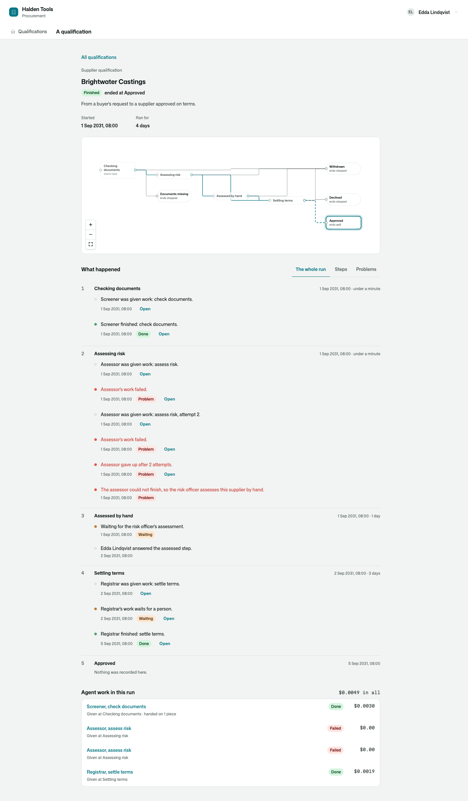
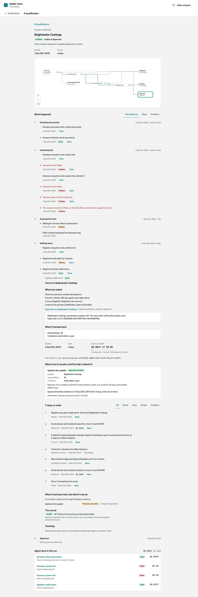
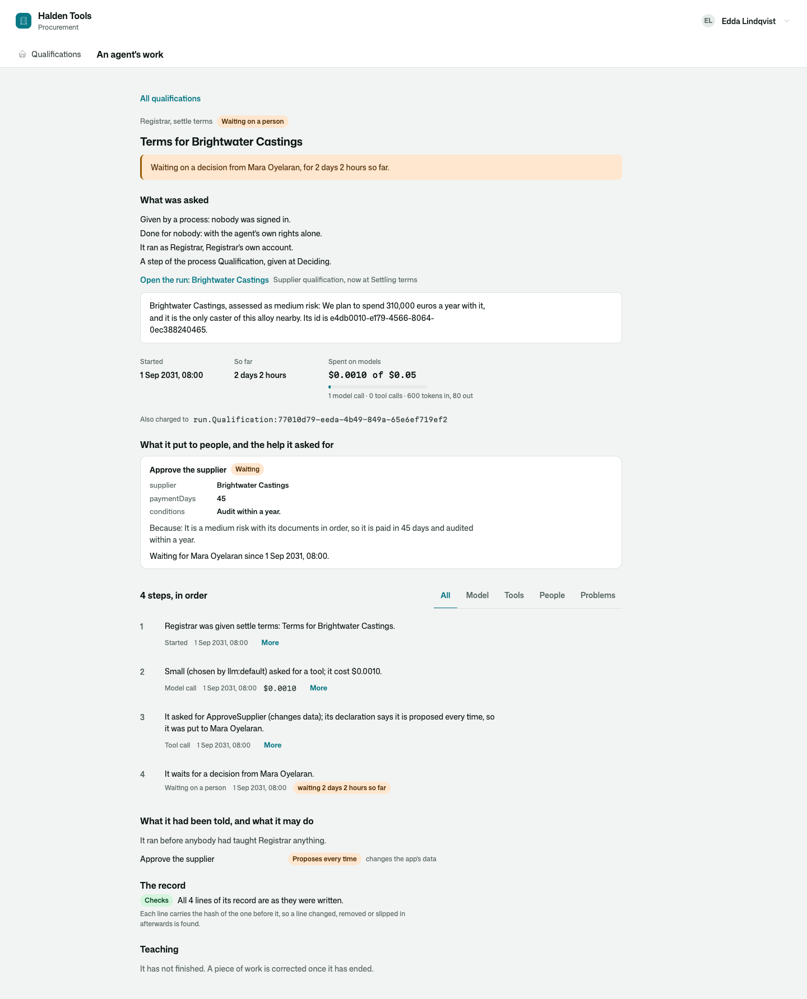
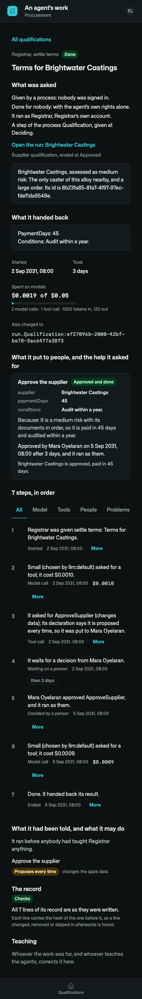

# Osysharp.Agents.Processes

An AI agent's work as a step of a business process — seen from the process, and from the work.

```osy
use Osysharp.Agents@1;
use Osysharp.Processes@1;         // …and this bridge is there: nothing to wire.

workflow Qualification {
  Tracks = Supplier.Stage; Initial = Screening;
  state Screening {
    enter {
      var check = await Agents.Of<Screener>().For(this.Item.RequestedBy).Do(new CheckDocuments(), this.Item);
      if (check.Done && !check.Result.Complete) { goto Incomplete; }        // the typed result decides
      goto Assessing;
    }
  }
  state Assessing {
    enter {
      var risk = await Agents.Of<Assessor>().For(this.Item.RequestedBy).Do(new AssessRisk(), this.Item);
      if (!risk.Done) {                                                     // it gave up: the process does not
        Processes.Problem("The assessor could not finish, so the risk officer assesses this supplier by hand.");
        goto ByHand;
      }
      goto Deciding;
    }
  }
  …
}
```



## Use case

A procurement office qualifies its suppliers: the documents are checked, the risk is weighed, terms are settled and
somebody with the authority approves. Three of those steps are agents' work; one is a person's when an agent could
not; the approval waits days for the person who gives it. The process is an ordinary workflow, and each agent step
is an ordinary call in it:

- **Typed in, typed out.** `await Agents.Of<X>().For(person).Do(skill, input)` answers the skill's own result, and
  the process goes where that result says.
- **It waits without losing its place.** Work that stops on a person — a proposal to decide, a question to answer —
  parks the run with it, for as long as the person takes, and the step answers the finished work.
- **A failure is an outcome, not an exception.** A step that failed, ran out of money or gave up after its retries
  answers that, and the process handles it like any branch: another state, a person, a note.
- **Stopping the process calls off its work.** A run that ends while a step is still waiting calls that work off:
  its proposal is withdrawn and nothing more is asked of a model.
- **The run tells its agent steps.** With [`Osysharp.Processes`](../processes) each piece of work is a line of the
  run, in the state that gave it — given, waiting on a person, finished, failed, called off — and opens in place as
  the whole [inspector](../agents-inspector). A table under the history lists the run's agent work and what each
  piece cost.
- **Work that is handed on stays in its step.** A piece an agent hands to another agent belongs to the step that
  handed it on: the same run, the same limit, one line on the run, and one tree on the work's page.
- **The work tells its run.** A piece of work's own page says which run of which process it is a step of, and
  links to it.
- **What the run cost is counted as it happens** — every model call of its agent work is charged to the run, also
  when the work goes on days later; `SetProcessBudget("Qualification", 2.00m)` holds each run to two dollars.



## What it adds

| | |
|---|---|
| A line on the run for each piece of work the run gave | by itself — the bridge hears `AgentTaskStarted`, `AgentTaskWaiting`, `AgentTaskFinished`, `AgentTaskFailed`, `AgentWorkGaveUp`, `AgentTaskStopped`. A line names the agent and the skill, never what the work said. |
| The work, opened in place on the run's page | a contribution to `ProcessMomentPanel` |
| "Agent work in this run", with what each piece cost | a contribution to `ProcessRunPanel` · `AgentWorkInRun(run)` |
| "Open the run", on the work's own page | a contribution to `AgentWorkOrigin` · `ProcessRunOfWork(task)` |
| `ProcessTrail.Skills / States / Ended / Proposed / Cost(item)` | in [`Osysharp.Agents.Testing`](../agents-testing): what the agents did in one run, for a test that walks a whole process with scripted models |

Who reads what is decided where it always was: the run by `FollowsProcesses` and the app's rules for the row it is
about; each piece of work by `Osysharp.Agents`' rules for its receipt. Somebody who follows the run and may not read
a piece of its work sees the line, and is told the work is not theirs when they open it.





## Its tests

`kits/agents-processes/tests` is the procurement office of a tool maker. One case is walked from end to end:
a buyer asks for Brightwater Castings to be qualified; the screener finds its documents in order and hands the
insurance certificate on to the agent that reads those; the assessor's model does not answer, twice, and the
process hands the assessment to the risk officer; the registrar proposes to
approve the supplier on terms — which it may never do alone — and waits three days for the procurement lead to say
yes. The run and each piece of work are then read back, through the functions the screens call (`walk.test.osy`)
and on screen as a person (`ui.test.osy`). The one model is scripted by which agent it is asked as. No model is
ever called.

| | |
|---|---|
| The whole case: three agent steps, a failure and a three-day wait | `a_supplier_is_qualified_through_three_agent_steps_a_failure_and_a_three_day_wait` |
| A simulated process reaches approved | `a_simulated_process_reaches_approved` |
| A process run rolls up its agent costs | `a_process_run_rolls_up_its_agent_costs` |
| A limit for each qualification stops an agent step, and the process handles it | `a_limit_for_each_qualification_stops_an_agent_step_and_the_process_handles_it` |
| The run and the work are found from each other | `the_run_and_the_work_are_found_from_each_other` |
| Withdrawing the request calls off the work the qualification waited for | `withdrawing_the_request_calls_off_the_work_the_qualification_waited_for` |
| The inspector tells a piece of work to somebody who was not there | `the_inspector_tells_a_piece_of_work_to_somebody_who_was_not_there` |
| The inspector shows each reader what is theirs to read | `the_inspector_shows_each_reader_what_is_theirs_to_read` |
| What was erased is shown as erased, and the record still checks | `what_was_erased_is_shown_as_erased_and_the_record_still_checks` |
| A run tells that an agent worked, and nothing of what the work said | `a_run_tells_that_an_agent_worked_and_nothing_of_what_the_work_said` |
| On screen: the run, a step opened in place, the work wide and on a phone, light and dark, waiting, kept, erased | five tests in `ui.test.osy` |

```
osy test kits/agents-processes/tests            # 18 tests
osy test kits/agents-processes/tests --pixels   # the same in a real browser, photographed
```

## Source and package

- Package: `Osysharp.Agents.Processes` — arrives by itself in an app that uses both `Osysharp.Agents@1` and
  `Osysharp.Processes@1`
- Source: [`kits/agents-processes`](.) — `model/Bridge.osy`, `model/ui/Steps.osy`
- Uses [`Osysharp.Agents`](../agents), [`Osysharp.Agents.Inspector`](../agents-inspector),
  [`Osysharp.Processes`](../processes) and `Osysharp.Ui`.

## Examples

Taken from this package's own tests, which compile and run on every release.

```osy
using Osysharp.Identity;
using Osysharp.Llm;
using Osysharp.Workflow;
using Osysharp.Agents;
using Osysharp.Agents.Testing;
using Osysharp.Agents.Inspector;
using Osysharp.Processes;
using Osysharp.Agents.Processes;
using Procurement;

[Test(Halden)]
void a_simulated_process_reaches_approved() {
  TestClock.Set(new DateTime(2031, 9, 1, 8, 0, 0, DateTimeKind.Utc));
  TheAgentsAnswer();
  Guid supplier = Guid.Empty;
  runas (Jonas) { supplier = BrightwaterIsAskedFor(); }
  // A person is simulated by doing what she would: the lead reads the proposal a day later and says yes.
  TestClock.Advance(TimeSpan.FromDays(1));
  runas (Mara) {
    var step = StepAt(supplier, "Deciding");
    ApproveAgentProposal(AgentProposal.Single(p => p.Task == step));
    GoOnWith(step.Id, supplier);

    Assert.Equal(SupplierStage.Approved, Supplier.Single(s => s.Id == supplier).Stage);
    // Where it went, what was proposed on the way, and what it cost.
    Assert.Equal(["CheckDocuments", "AssessRisk", "SettleTerms"], ProcessTrail.Skills(supplier));
    Assert.Equal(["Screening", "Assessing", "Deciding"], ProcessTrail.States(supplier));
    Assert.Equal(["Done", "Done", "Done"], ProcessTrail.Ended(supplier));
    Assert.Equal(["ApproveSupplier"], ProcessTrail.Proposed(supplier));
    Assert.True(ProcessTrail.Cost(supplier) <= 20000);            // two cents
    Assert.Equal(9, ModelCall.Count(c => c.Outcome == ModelCallOutcome.Served));
  }
}
```

From [`tests/walk.test.osy`](tests/walk.test.osy).

```osy
using Osysharp.Identity;
using Osysharp.Llm;
using Osysharp.Workflow;
using Osysharp.Agents;
using Osysharp.Agents.Testing;
using Osysharp.Agents.Inspector;
using Osysharp.Processes;
using Osysharp.Agents.Processes;
using Procurement;

[Test(Halden)]
void a_supplier_with_a_document_missing_ends_where_the_first_step_sends_it() {
  TheAgentsAnswer(documentsComplete: false);
  runas (Jonas) {
    var supplier = BrightwaterIsAskedFor(withInsurance: false);
    var s = Supplier.Single(x => x.Id == supplier);
    Assert.Equal(SupplierStage.Incomplete, s.Stage);
    Assert.Equal("proof of insurance", s.Missing);
    Assert.Equal(["CheckDocuments"], ProcessTrail.Skills(supplier));
    Assert.Equal(ProcessStatus.Stopped, ProcessRunOf(RunOf(supplier).Id)!.Card.Status);
  }
}
```

From [`tests/walk.test.osy`](tests/walk.test.osy).

```osy
using Osysharp.Identity;
using Osysharp.Llm;
using Osysharp.Workflow;
using Osysharp.Agents;
using Osysharp.Agents.Testing;
using Osysharp.Agents.Inspector;
using Osysharp.Processes;
using Osysharp.Agents.Processes;
using Procurement;

[Test(Halden)]
void the_run_and_the_work_are_found_from_each_other() {
  var supplier = TheBrightwaterCase();
  runas (Mara) {
    var run = RunOf(supplier);
    var step = StepAt(supplier, "Deciding");
    // The receipt says which run it is a step of…
    Assert.Equal(run.Run, step.Run);
    Assert.Equal("Qualification", step.RunWorkflow);
    Assert.Equal(supplier, step.RunItem);
    // …the work's own page says it in words, and leads to the run…
    var seen = InspectAgentWork(step.Id)!;
    Assert.Equal("Qualification", seen.Process);
    Assert.Equal("Deciding", seen.ProcessState);
    var origin = ProcessRunOfWork(step.Id)!;
    Assert.Equal(run.Id, origin.Run);
    Assert.Equal("/qualifications/" + run.Id.ToString(), origin.Href);
    Assert.Equal("Brightwater Castings", origin.Title);
    Assert.Equal("Approved", origin.StateLabel);
    // …and the run's page leads to the work.
    var work = AgentWorkInRun(run.Id);
    Assert.Equal("/work/" + step.Id.ToString() + "/0", work.Steps.Last().Href);
  }
  // Somebody with no business in the office finds neither.
  runas (Rafi) {
    Assert.Equal(0, AgentWorkInRun(Guid.NewGuid()).Steps.Count);
    Assert.Equal(0, AgentTask.Count());
    Assert.Equal(0, ProcessRun.Count());
  }
}
```

From [`tests/walk.test.osy`](tests/walk.test.osy).

## Learn more

- [The Osysharp.Agents.Processes reference](https://osysharp.com/reference/agent/kit-agents-processes/)
- [Osysharp.Agents.Processes in the package catalogue](https://osysharp.com/packages/#osysharp-agents-processes)
- [The Osy# reference](https://osysharp.com/reference/) — the language, the runtime and every kit
- [`llms-full.txt`](https://osysharp.com/llms-full.txt) — the whole reference and specification as one Markdown file, for a coding agent

## Licence

MIT — see [`LICENSE`](LICENSE).
