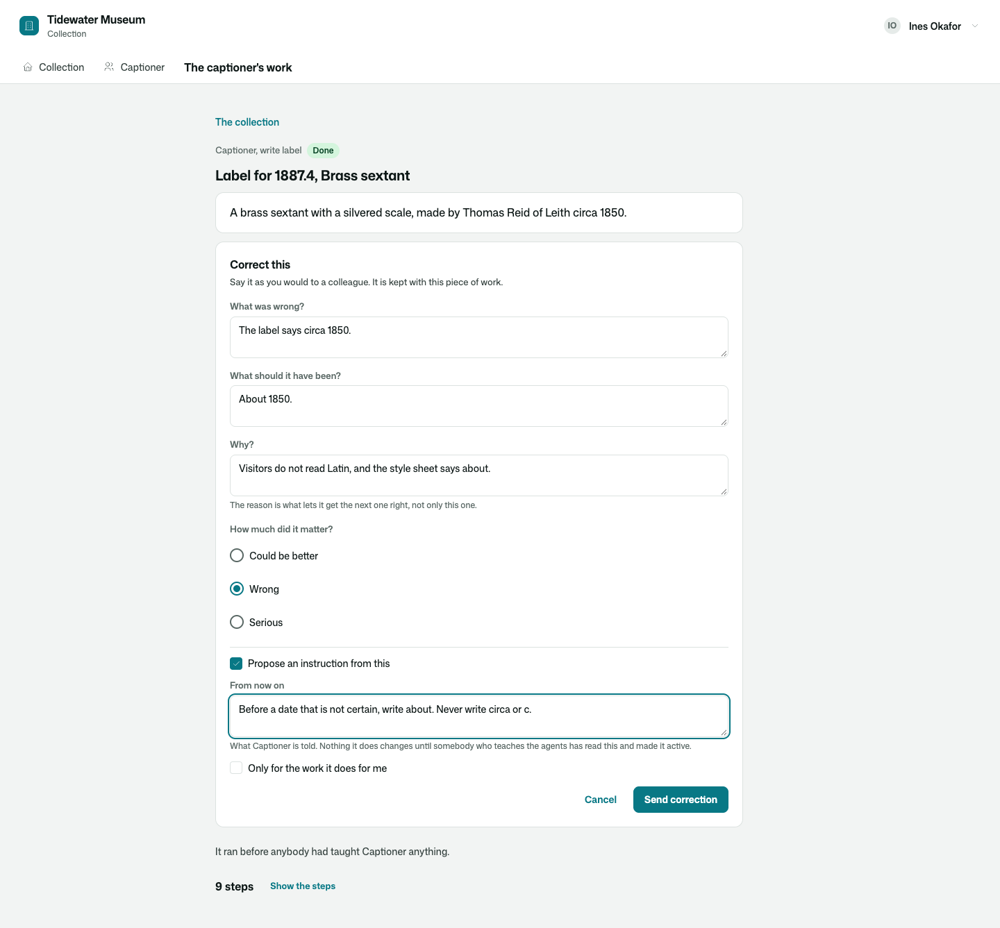
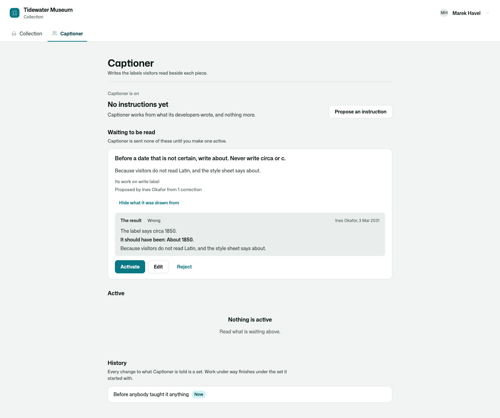
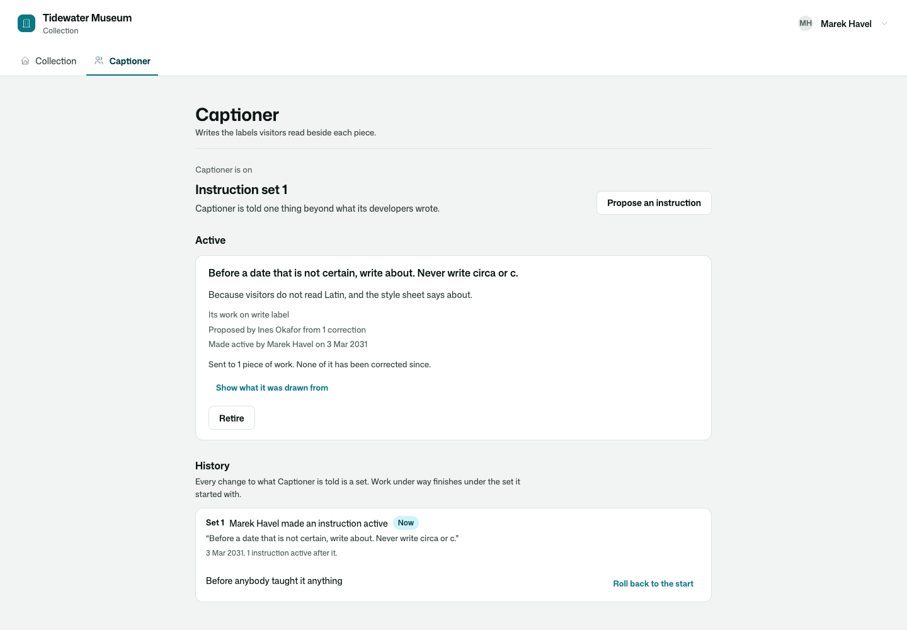
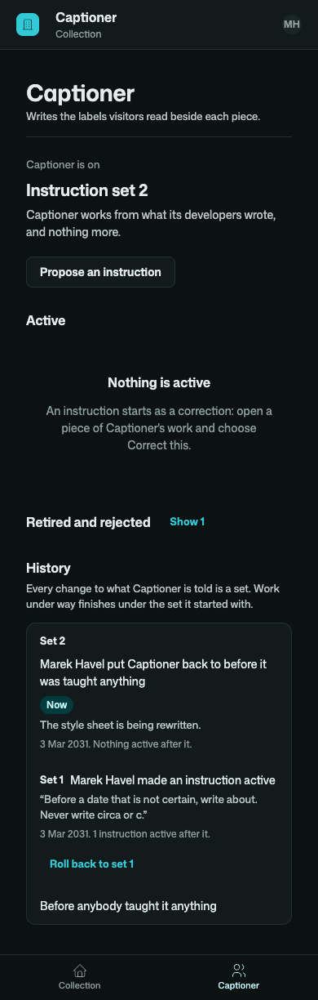

# Osysharp.Agents.Teaching

The two places people teach an AI agent, drawn: **Correct this** on a piece of its work, and the agent's
**Instructions** page.

```osy
use Osysharp.Agents@1;
use Osysharp.Agents.Teaching@1;

[Route("/work/{task}")] [Authorize(UsesAgents)]
component WorkPage(Guid task) { render { WorkTeaching(task); } }

[Route("/agents/captioner")] [Authorize(UsesAgents)]
component CaptionerPage() { render { AgentInstructions(Agents.Of<Captioner>().Name); } }
```



## Use case

An agent that is wrong the same way twice is an agent nobody was able to tell. The person who notices is rarely a
developer, and what they know — "we say *about*, not *circa*" — has to get from the piece of work they are looking
at into what the agent is told, without becoming a rule nobody read.

- **Correct this, where the work is.** On the result, on one step of the record, on something the agent proposed:
  what was wrong, what it should have been, and why. Three questions, in place, on a phone as on a desk.
- **A correction can become an instruction in the same breath** — the person says what the agent should be told
  from now on, for all that work or only for the work it does for them.
- **Nothing changes until somebody who teaches the agents has read it.** The Instructions page shows what is
  waiting, with the corrections it was drawn from. Activate, Edit or Reject.
- **What the agent is told is one page.** What is active, since when, who decided, what work it is for — and
  whether it helped: how much work was sent it, and how often people still corrected that work.
- **Every change can be undone.** Retire an instruction, or put the agent back to any earlier set from its history;
  each asks why, and the history says who did what.
- **Each piece of work says what it ran under**, and what the agent has been told since that it had not been.



## What it draws

| | |
|---|---|
| `WorkTeaching(task)` | One piece of work, for teaching: what it handed back with **Correct this**, what it was told when it ran and what it has been told since, the corrections made so far, and its steps — each with its own button once shown. Says so when the work is not whoever-is-looking's to see. |
| `CorrectThis(task, step:, proposal:, label:, agent:, changed:, quiet:)` | The button alone, for a run page of your own. Pressed, it opens in place. |
| `AgentInstructions(agent)` | An agent's page: where it stands (its instruction set), what is waiting to be read, what is active, what is retired or rejected, and the history of every set — with Activate, Edit, Reject, Retire, Activate again, Roll back and Propose an instruction for those who may. |
| `CorrectionLine(card)` | One correction as it reads on the work. |
| `WorkTeachingOf(task)` · `InstructionBoardOf(agent)` · `SendCorrection(task, form)` | What the screens read and send, for a screen of your own. |

The screens decide nothing: who may correct, who may make an instruction active, retire one or roll back is
[`Osysharp.Agents`](../agents)' to say. A control somebody may not use is not offered, and one that is refused says
why in the kit's own words.





Under a page that already shows the work — [`Osysharp.Agents.Inspector`](../agents-inspector) — `WorkTeaching(task,
beside: true)` draws only what teaching adds: **Correct this**, the corrections made so far, and each step's button.

## Its tests

`kits/agents-teaching/tests` is a small maritime museum whose labels are written by an agent. One case is walked
from end to end, twice — through the functions the screens call (`walk.test.osy`) and on screen as a person
(`ui.test.osy`): the captioner writes *circa* on a label; a curator corrects it and proposes what it should be told;
the next label is as wrong as the first, because the model was sent nothing; the registrar reads the proposal and
makes it active; the next label says *about*; each piece of work says which instruction set it ran under; and a
rollback brings the old labels back. The model is scripted **by what it is sent**, so a label changes exactly when
the instruction reaches it. No model is ever called.

| | |
|---|---|
| A mistake is corrected, taught and then rolled back | `a_mistake_is_corrected_taught_and_then_rolled_back` |
| A piece of work is shown to those it is for, and corrected by them | `a_piece_of_work_is_shown_to_those_it_is_for_and_corrected_by_them` |
| A curator corrects a label and proposes an instruction from it (wide, and a step on a phone) | `a_curator_corrects_a_label_and_proposes_an_instruction_from_it` |
| The registrar reads, activates and rolls back on the agent's page | `the_registrar_reads_activates_and_rolls_back_on_the_agents_page` |
| The registrar proposes, edits, rejects and retires | `the_registrar_proposes_edits_rejects_and_retires` |
| Work that is not yours says so | `work_that_is_not_yours_says_so` |

```
osy test kits/agents-teaching/tests            # 6 tests
osy test kits/agents-teaching/tests --pixels   # the same in a real browser, photographed wide and on a phone, light and dark
```

## Source and package

- Package: `Osysharp.Agents.Teaching` — `use Osysharp.Agents.Teaching@1;`
- Source: [`kits/agents-teaching`](.) — `model/Views.osy` (what the screens read and send), `model/ui/Correct.osy`
  (`CorrectThis`, `WorkTeaching`), `model/ui/Instructions.osy` (`AgentInstructions`)
- Uses [`Osysharp.Agents`](../agents) (corrections, instructions, instruction sets) and `Osysharp.Ui`.

## Examples

Taken from this package's own tests, which compile and run on every release.

```osy
using Osysharp.Identity;
using Osysharp.Llm;
using Osysharp.Agents;
using Osysharp.Agents.Testing;
using Osysharp.Agents.Teaching;
using Museum;

[Test(Rooms)]
void a_piece_of_work_is_shown_to_those_it_is_for_and_corrected_by_them() {
  Guid task = Guid.Empty;
  runas (Ines) {
    task = LabelFor("1887.4", "first");
    var view = WorkTeachingOf(task)!;
    Assert.True(view.MayCorrect);
    Assert.True(view.Ended);
    Assert.Equal("Captioner", view.Name);
    Assert.Equal("write label", view.Skill);
    Assert.Equal("Label for 1887.4, Brass sextant", view.About);
    Assert.Equal("A brass sextant with a silvered scale, made by Thomas Reid of Leith circa 1850.", view.Result);
    Assert.Equal(9, view.Steps.Count);
    Assert.Equal("Captioner was given write label: Label for 1887.4, Brass sextant.", view.Steps[0].Said);
    // A step is corrected by its place in the record.
    SendCorrection(task, new CorrectionForm { Wrong = "It copied the entry.", Right = "Say it for a visitor.", Because = "Nobody reads a catalogue aloud.", Step = 6 });
    UnitOfWork.Commit();
    var corrected = WorkTeachingOf(task)!.Corrections.Single();
    Assert.StartsWith("Step 6: ", corrected.About);
    // Nothing was proposed: she did not ask for it.
    Assert.Equal(0, InstructionBoardOf(TheCaptioner).Proposed.Count);
  }
  // Another curator's work is not June's to see, and so not hers to correct.
  runas (June) {
    Assert.Null(WorkTeachingOf(task));
    Assert.Throws<AgentRefused>(() => SendCorrection(task, new CorrectionForm { Wrong = "x", Right = "y", Because = "z" }));
  }
}
```

From [`tests/walk.test.osy`](tests/walk.test.osy).

```osy
using Osysharp.Identity;
using Osysharp.Llm;
using Osysharp.Agents;
using Osysharp.Agents.Testing;
using Osysharp.Agents.Teaching;
using Museum;

[Test(Rooms)]
void work_that_is_not_yours_says_so() {
  var task = TheSextantIsLabelled();
  Ui.Viewport(390, 844);
  Ui.SignInAs(June);
  Ui.Visit("/work/" + task);
  Assert.Visible("This piece of work is not yours to see");
  Assert.Hidden("Correct this");
  Assert.NoOverflow();
  Ui.Shot("work-not-yours-phone-light");
}
```

From [`tests/ui.test.osy`](tests/ui.test.osy).

## Learn more

- [The Osysharp.Agents.Teaching reference](https://osysharp.com/reference/agent/kit-agents-teaching/)
- [Osysharp.Agents.Teaching in the package catalogue](https://osysharp.com/packages/#osysharp-agents-teaching)
- [The Osy# reference](https://osysharp.com/reference/) — the language, the runtime and every kit
- [`llms-full.txt`](https://osysharp.com/llms-full.txt) — the whole reference and specification as one Markdown file, for a coding agent

## Licence

MIT — see [`LICENSE`](LICENSE).
